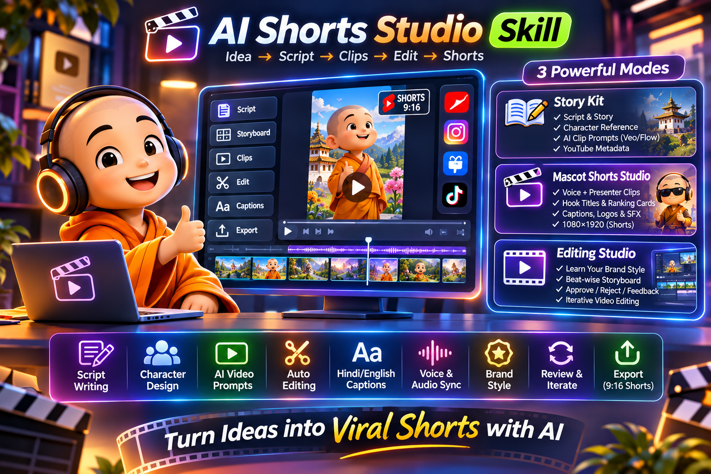

# AI Shorts Studio Skill (हिंदी गाइड)

[](https://github.com/i-smiling-buddha/ai-shorts-studio-skill/stargazers)
[](LICENSE)
[](https://agentskills.io)
[](https://github.com/i-smiling-buddha/ai-shorts-studio-skill/actions/workflows/ci.yml)
[](https://skills.sh/i-smiling-buddha/ai-shorts-studio-skill)



**YouTube Shorts के लिए आपका AI video editor। Plan · Generate · Edit · Review.**

> अपनी voice recording और clips एक folder में डालिए, "start editing" बोलिए। आपका agent beats काटता है और storyboard बनाता है, जिसमें आप हर card को Approve या Reject करते हैं। फिर वो आपके notes से अगला draft आपके channel के style में बनाता है।

Claude Code, Claude (claude.ai / desktop), OpenAI Codex, Gemini CLI, GitHub Copilot, Cursor और हर [Agent Skills](https://agentskills.io) वाले agent के साथ काम करती है। Free और open source है।

English: [README.md](README.md)

⭐ **काम की लगे तो repo को star कीजिए।** इससे दूसरे creators तक ये skill पहुँचती है।

ये skill एक faceless AI-tools channel (Techie Monk) के असली Shorts बनाते हुए तैयार हुई है। इसलिए इसका हर नियम किसी असली गलती से निकला है:
- mask "बोलने" लगा
- board में mascot crop हो गया
- एक ही clip पूरे एक minute loop होता रहा
- products के नाम बिना logo के दिखे
- बिना पूछे render होकर credits खर्च हो गए

## एक skill, तीन modes

| Mode | आप देते हैं | आपको मिलता है |
|---|---|---|
| **A — Story kit** | topic (history, mythology, kids 3D, viral cute, custom) | script, character reference sheets, numbered 8-second Google Flow / Veo clip prompts, assembly commands, title/description/hashtags |
| **B — Mascot Shorts Studio** | voice recording + आपकी presenter clip library | तैयार 1080×1920 Short: hook title, official logos वाले rank cards, split-screen boards, 3-word captions, SFX, follow/comment outro |
| **C — Editing Studio** | आपकी files वाला एक folder | studio folders, आपकी videos से सीखा brand kit, beat cuts, Approve / Reject storyboard, आपके notes से अगला draft |

## Install

```bash
npx skills add i-smiling-buddha/ai-shorts-studio-skill
```

**Claude Code plugin:**

```
/plugin marketplace add i-smiling-buddha/ai-shorts-studio-skill
/plugin install ai-shorts-studio-skill@ai-shorts-studio-skill
```

**Claude (claude.ai / desktop app):**
1. `skills/ai-shorts-studio` folder को zip कीजिए।
2. उसे **Settings → Capabilities → Skills** में upload कीजिए।
3. Claude desktop app से अपना folder link कीजिए, ताकि skill आपकी clips पढ़ सके और drafts वहीं save कर सके।

**Manual:** `skills/ai-shorts-studio` folder को अपने agent के skills folder में copy कीजिए। Claude Code के लिए ये `~/.claude/skills/` है। Codex, Copilot, Gemini CLI और Cursor के लिए `.agents/skills/` है।

### ज़रूरी चीज़ें

- Python 3.10+ और [FFmpeg](https://ffmpeg.org)
- `pip install numpy opencv-python-headless pillow` (Hindi/Devanagari text के लिए Pillow में raqm होना चाहिए)
- Optional: free offline Hindi/English transcription के लिए `pip install sherpa-onnx soundfile`
- Optional: नई clips बनाने के लिए [Google Flow](https://labs.google/flow) account। इसमें आपके Flow credits लगते हैं, और skill हमेशा पहले पूछती है।

Fonts (Anton और Devanagari वाला Poppins Bold, SIL Open Font License) `fonts/` में साथ आते हैं।

## Mode C — Editing Studio (beginners के लिए)

**"start editing"** बोलिए। Skill ये folders बना देगी:

```
Studio/
  Brand Kit/          brand-kit.md, channel emblem, fonts
  References/         जिन videos का style आपको पसंद है
  Approved Videos/    आपकी अपनी पसंद की finished videos
  A-roll/             voice recording(s)
  Raw Clips/          presenter clips (9:16 और square)
  Media Data/         logos, images, B-roll, music
  Storyboard/         beats.json, notes.json, Cuts/
  Finished Videos/    drafts और finals
```

इसके बाद ये होता है:
1. Skill References और Approved Videos से हर second का एक frame देखकर आपका style `brand-kit.md` में लिखती है।
2. A-roll को beats में काटती है और storyboard देती है।
3. आप हर card पर **Approve** या **Reject** दबाते हैं, feedback लिखते हैं, और **"review done"** बोलते हैं।
4. Skill आपके notes `notes.json` में save करती है और अगले draft का plan दिखाती है।
5. आपके "हाँ" कहने पर ही render होता है।
6. हर approved बदलाव brand kit में जुड़ जाता है, ताकि अगली video शुरू से आपके style में बने।

## क्या-क्या करती है

| हिस्सा | आपको क्या मिलता है |
|---|---|
| **Clip library** | दोबारा इस्तेमाल होने वाली presenter clips की `library.json`। `916_` = full screen, `sq_` = board panel। हर clip gesture के हिसाब से tagged। |
| **Mask & hand QA** | हर clip full size में check होती है। Mask पर mouth/smile या गलत दिखने वाला gesture पहले ही पकड़ा जाता है। |
| **Mask fix** | `maskclean.py` mask पर बना mouth हटाकर fabric texture वापस लाता है। |
| **Board layout** | ऊपर rank card (~945 px) और नीचे पूरी square clip। 9:16 clip कभी crop नहीं होती। |
| **Official logos** | आपकी दी हुई logo files बिना बदलाव के लगती हैं। AI से logo कभी नहीं बनता। |
| **Captions** | 3-word pop-in captions, Hindi + English। Hot words रंगीन होते हैं (AI cyan, MISS red, FOLLOW green)। |
| **No loops** | हर scene में अलग clip। Library छोटी हो तो skill बताती है कि कौन-सी clips और बनानी हैं। |
| **Pacing** | हर 2–4 s में बदलाव, list items 6–8 s के। One-click AI editors जितनी जल्दबाज़ी नहीं। |
| **Pre-render QC** | `qc.py pre` render से पहले ही ये गलतियाँ पकड़ता है: timeline में gap या overlap, voice पूरी cover न होना, clip repeat या missing, बहुत छोटी clip (जो loop हो जाती), board पर 9:16 clip, card fields/logos की कमी, बहुत तेज़ captions। |
| **Post-render QC** | `qc.py post` बनी हुई video को PASS / WARN / FAIL देता है। Check होते हैं: 1080×1920 / 30 fps, duration, loudness (−14 LUFS, true peak ≤ −1), black frames, frozen video, silence और तेज़ flashes। साथ में हर cut की contact sheet बनती है। |
| **हर agent में चलता है** | Claude में storyboard के notes artifact database में save होते हैं। दूसरी जगह browser में save होते हैं, और `notes.json` Download / Import कर सकते हैं। Disk पर रखी file से भी खुलता है। |
| **Credit safety** | आपके OK के बिना कोई render या generation नहीं। पहले plan और stills दिखते हैं। |

## Quick examples

- "Start editing — मेरी files Editing Studio folder में हैं।"
- "इस voice note और मेरी mascot clips से Top 5 AI tools Short बनाओ।"
- "इन Flow clips को check करो: कहीं mask पर mouth तो नहीं दिख रहा?"
- "इस clip का mask ठीक करो।"
- "Mughal empire पर Google Flow के लिए 10 minute की history video plan करो।"
- "Review done — draft 2 बनाओ।"

Renderer खुद चलाना हो तो:

```bash
python skills/ai-shorts-studio/scripts/qc.py pre timeline.json                        # plan check
python skills/ai-shorts-studio/scripts/studio.py timeline.json out/short.mp4 --stills   # preview frames
python skills/ai-shorts-studio/scripts/studio.py timeline.json out/short.mp4            # full render
python skills/ai-shorts-studio/scripts/maskclean.py clip.mp4 clip_fixed.mp4 --ref 0.5
```

## FAQ

**क्या Google Flow ज़रूरी है?** नहीं। Flow सिर्फ़ नई clips बनाने के लिए है। Editing, storyboard और rendering आपकी अपनी clips से आपकी machine पर चलते हैं।

**क्या ये मेरे credits खर्च करेगी?** बिना पूछे नहीं। पहले plan और preview stills दिखाती है, फिर आपके OK का इंतज़ार करती है।

**क्या masked mascot की जगह अपना presenter इस्तेमाल कर सकते हैं?** हाँ। Library, boards, captions और storyboard किसी भी clips के साथ चलते हैं। Mask check और `maskclean.py` सिर्फ़ masked characters के लिए हैं।

**Logos कहाँ से आएँगे?** सिर्फ़ आपकी दी हुई files से। सबसे अच्छा है हर company के press/brand kit से लेना। Logo का इस्तेमाल उस company की brand guidelines के हिसाब से ही करें।

## Credits

- Editing Studio का review loop [@AbdulMoizCreator](https://www.youtube.com/@AbdulMoizCreator) के Short "How to Edit like a Pro with Claude" से inspired है।
- Quality-control के ideas [kajisho5/ffmpeg-skill](https://github.com/kajisho5/ffmpeg-skill) और [browser-use/video-use](https://github.com/browser-use/video-use) से लिए हैं (code नहीं, सिर्फ़ ideas)।
- Offline speech recognition: [sherpa-onnx](https://github.com/k2-fsa/sherpa-onnx)।
- Fonts: [Anton](https://github.com/googlefonts/AntonFont) और [Poppins](https://github.com/itfoundry/Poppins) (SIL OFL)।

## Smiling Buddha की और free skills

पूरी list [README.md](README.md#more-free-skills-by-smiling-buddha) में है: AI Video Vision, PPT Animation, Countdown Video, Smart Model Router, AI Image Recognition, Reflection और AI Blender Animation।

## License

MIT. Made by [Smiling Buddha](https://github.com/i-smiling-buddha) · [DESITechnology](https://desitechnology.com).
