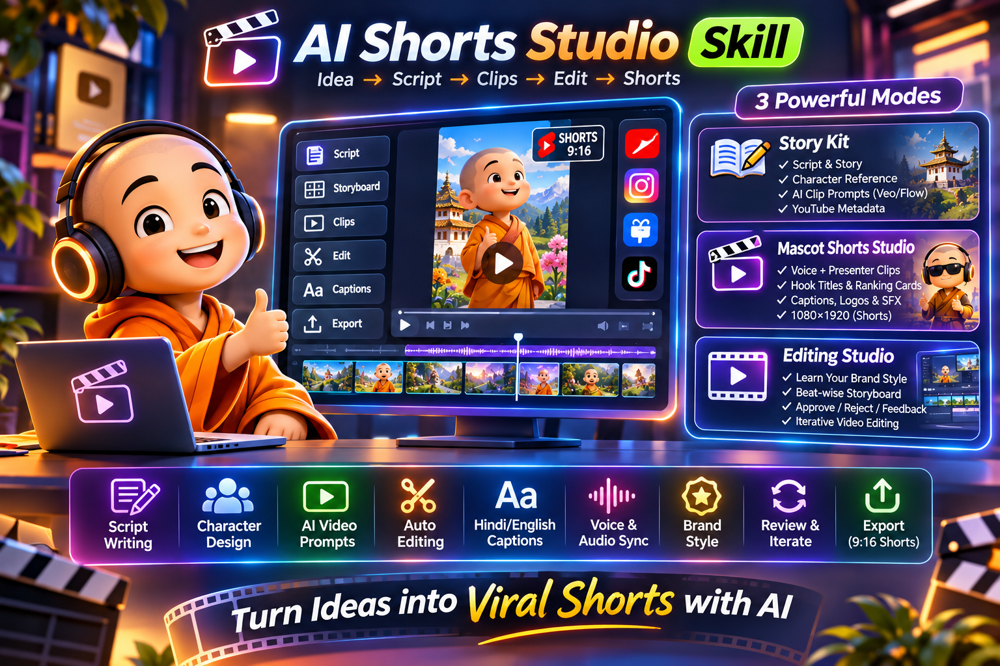

# AI Shorts Studio Skill

[](https://github.com/i-smiling-buddha/ai-shorts-studio-skill/stargazers)
[](LICENSE)
[](https://agentskills.io)
[](https://github.com/i-smiling-buddha/ai-shorts-studio-skill/actions/workflows/ci.yml)
[](https://skills.sh/i-smiling-buddha/ai-shorts-studio-skill)



**Your AI video editor for YouTube Shorts. Plan · Generate · Edit · Review.**

> Drop your voice recording and clips into a folder, say "start editing", and your agent cuts the beats, builds a storyboard you approve or reject card by card, and renders the next draft from your notes, in your channel's own style.

Works with **Claude Code, Claude (claude.ai / desktop), OpenAI Codex, Gemini CLI, GitHub Copilot, Cursor** and any agent that supports [Agent Skills](https://agentskills.io). Free, open source.

[Install](#install) · [What it does](#what-it-does) · [Editing Studio](#mode-c--editing-studio-for-beginners) · [Examples](#quick-examples) · [FAQ](#faq) · हिंदी गाइड: [README.hi.md](README.hi.md)

⭐ **If it saves you time, star the repo** — it helps other creators find it.

Built while making real Shorts for a faceless AI-tools channel (Techie Monk), so every rule in it comes from a mistake that actually happened: a mask that started "talking", a board that cropped the mascot, one clip looped for a whole minute, product names without logos, renders that burned credits without asking.

## Three modes in one skill

| Mode | You give | You get |
|---|---|---|
| **A — Story kit** | a topic (history, mythology, kids 3D, viral cute, custom) | script, character reference sheets, numbered 8-second Google Flow / Veo clip prompts, assembly commands, title/description/hashtags |
| **B — Mascot Shorts Studio** | a voice recording + your presenter clip library | a finished 1080×1920 Short: hook title, rank cards with official logos, split-screen boards, 3-word captions, SFX, follow/comment outro |
| **C — Editing Studio** | one folder with your files | studio folders, a brand kit learned from your videos, beat cuts, an Approve / Reject storyboard, the next draft from your notes |

## Install

Install with the open Agent Skills CLI:

```bash
npx skills add i-smiling-buddha/ai-shorts-studio-skill
```

**Claude Code plugin:**

```
/plugin marketplace add i-smiling-buddha/ai-shorts-studio-skill
/plugin install ai-shorts-studio-skill@ai-shorts-studio-skill
```

**Claude (claude.ai / desktop app):** zip the `skills/ai-shorts-studio` folder and upload it under **Settings → Capabilities → Skills**. Link a folder from the Claude desktop app so the skill can read your clips and save drafts there.

**Manual:** copy `skills/ai-shorts-studio` into your agent's skills folder (`~/.claude/skills/`, or `.agents/skills/` for Codex, Copilot, Gemini CLI and Cursor).

### Requirements

- Python 3.10+ and [FFmpeg](https://ffmpeg.org)
- `pip install numpy opencv-python-headless pillow` (Pillow with raqm, for Hindi/Devanagari text)
- Optional: `pip install sherpa-onnx soundfile` for free offline Hindi/English transcription
- Optional: a [Google Flow](https://labs.google/flow) account to generate new clips (uses your Flow credits — the skill always asks first)

Fonts (Anton, Poppins Bold with Devanagari, SIL Open Font License) are bundled in `fonts/`.

## What it does

| Part | What you get |
|---|---|
| **Clip library** | `library.json` of reusable presenter clips: `916_` (full screen) and `sq_` (board panel), tagged by gesture |
| **Mask & hand QA** | every clip checked at full size: mouth/smile shapes on a fabric mask and rude-looking gestures are caught before use |
| **Mask fix** | `maskclean.py` flattens mouth shapes a video model paints on a mask and restores the fabric texture |
| **Board layout** | rank card on top (~945 px), the whole square clip below, never a cropped 9:16 |
| **Official logos** | your logo files, composited unchanged next to the rank, never AI-generated or redrawn |
| **Captions** | 3-word pop-in captions, Hindi + English, hot words coloured (AI cyan, MISS red, FOLLOW green) |
| **No loops** | one distinct clip per scene; if the library is short it tells you which clips to make |
| **Pacing** | a change every 2–4 s, list items 6–8 s: not as rushed as AI one-click editors |
| **Flow helper** | calm-gesture prompts with a mask guard, Flow UI notes, "Audio generation failed" fix |
| **Brand kit** | `Brand Kit/brand-kit.md` learned from your reference + approved videos (1 frame per second) |
| **Storyboard** | one card per beat with the cut playing, captions, B-roll, assets, Approve / Reject / Feedback |
| **Draft loop** | notes saved to `notes.json`, next draft planned from them, approved changes added to the brand kit |
| **Free B-roll** | five code-rendered styles (code editor, search → sources → answer, multimodal orbit, mind-map, chat) inside the board panel: shows what each tool does, costs no credits, no fake product screens or logos |
| **Pre-render QC** | `qc.py pre` catches gaps, overlaps, scenes that don't cover the voice, repeated or missing clips, clips too short (would loop), 9:16 on a board, missing card fields/logos, unreadable caption speed — before a single frame is rendered |
| **Post-render QC** | `qc.py post` grades the file PASS / WARN / FAIL: 1080×1920 / 30 fps, duration vs voice, loudness (−14 LUFS, true peak ≤ −1 dBTP), black frames, frozen video, silence gaps, harsh flashes, plus a contact sheet of every cut to look at |
| **Works in any agent** | the storyboard saves to Claude's artifact database when available, otherwise in your browser with Download / Import `notes.json` — also from a file on disk |
| **Credit safety** | never renders or generates without your OK: plan and stills first |

## Mode C — Editing Studio (for beginners)

Say **"start editing"**. The skill creates:

```
Studio/
  Brand Kit/          brand-kit.md, channel emblem, fonts
  References/         videos whose style you like
  Approved Videos/    your own finished videos you are happy with
  A-roll/             voice recording(s)
  Raw Clips/          presenter clips (9:16 and square)
  Media Data/         logos, images, B-roll, music
  Storyboard/         beats.json, notes.json, Cuts/
  Finished Videos/    drafts and finals
```

Then it learns your style, cuts the A-roll into beats and gives you a storyboard. You click **Approve** or **Reject**, write feedback, and say **"review done"**. It saves your notes, shows the plan for the next draft, and renders only when you say yes. Every approved change goes into your brand kit, so the next video starts in your style.

## Quick examples

Just ask your agent:

- "Start editing — my files are in the Editing Studio folder."
- "Make a Top 5 AI tools Short from this voice note with my mascot clips."
- "Check these Flow clips: does the mask show a mouth anywhere?"
- "Fix the mask on this clip."
- "Plan a 10-minute history video on the Mughal empire for Google Flow."
- "Review done — make draft 2."

Or run the renderer yourself:

```bash
python skills/ai-shorts-studio/scripts/qc.py pre timeline.json                        # check the plan
python skills/ai-shorts-studio/scripts/studio.py timeline.json out/short.mp4 --stills   # preview frames
python skills/ai-shorts-studio/scripts/studio.py timeline.json out/short.mp4            # full render
python skills/ai-shorts-studio/scripts/qc.py post out/short.mp4 --timeline timeline.json --sheet out/cuts.jpg
python skills/ai-shorts-studio/scripts/maskclean.py clip.mp4 clip_fixed.mp4 --ref 0.5
```

Sample `library.json`, `timeline.json` and `beats.json` are in `skills/ai-shorts-studio/examples/`.

## FAQ

**Does it need Google Flow?** No. Flow is only used to generate new clips. Editing, the storyboard and rendering run on your machine with your own clips.

**Will it spend my credits?** Not without asking. It shows the plan and preview stills first and waits for your OK before any render or generation.

**Can I use my own presenter instead of a masked mascot?** Yes. The library, boards, captions and storyboard work with any clips. The mask check and `maskclean.py` are only needed for masked characters.

**Hindi captions?** Yes: Devanagari + English tech words, with an offline Hindi transcriber. Other languages work too.

**Where do logos come from?** Only files you supply (best from each company's press/brand kit). Each company's brand guidelines govern how its logo may be used.

## Credits

- The Editing Studio review loop (reference frames → brand kit → beat cuts → storyboard with Approve / Reject / Feedback → notes → next draft) was inspired by [@AbdulMoizCreator](https://www.youtube.com/@AbdulMoizCreator)'s Short "How to Edit like a Pro with Claude".
- Quality-control ideas adapted (no code copied) from [kajisho5/ffmpeg-skill](https://github.com/kajisho5/ffmpeg-skill) (graded PASS / WARN / FAIL content checks) and [browser-use/video-use](https://github.com/browser-use/video-use) (inspect the render at every cut, loudness targets, capped self-review passes, a per-project decision log). [Tella's video skills](https://www.tella.com/skills) confirmed the plan-first, render-after-approval rule.
- Offline speech recognition by [sherpa-onnx](https://github.com/k2-fsa/sherpa-onnx). Fonts: [Anton](https://github.com/googlefonts/AntonFont) and [Poppins](https://github.com/itfoundry/Poppins) (SIL OFL).

Built on [FFmpeg](https://ffmpeg.org), [OpenCV](https://opencv.org) and [Pillow](https://python-pillow.org).

## More free skills by Smiling Buddha

- **[AI Video Vision Skill](https://github.com/i-smiling-buddha/ai-video-vision-skill)** — let your agent watch any video: transcripts, smart frames, structure analysis. `npx skills add i-smiling-buddha/ai-video-vision-skill`
- **[PPT Animation Skill](https://github.com/i-smiling-buddha/ppt-animation-skill)** — turn any topic into a Kurzgesagt-style animated explainer video with an offline Hindi/English voiceover. `npx skills add i-smiling-buddha/ppt-animation-skill`
- **[Countdown Video Skill](https://github.com/i-smiling-buddha/countdown-video-skill)** — Top-N countdown and year-by-year evolution videos with rank reveals, trailer clips, music and YouTube chapters. `npx skills add i-smiling-buddha/countdown-video-skill`
- **[Smart Model Router Skill](https://github.com/i-smiling-buddha/smart-model-router-skill)** — route each coding task to the cheapest model that can reliably do it. `npx skills add i-smiling-buddha/smart-model-router-skill`
- **[AI Image Recognition Skill](https://github.com/i-smiling-buddha/ai-image-recognition-skill)** — real transparency, format, size, colors, blur and metadata checks on the actual image file. `npx skills add i-smiling-buddha/ai-image-recognition-skill`
- **[Reflection Skill](https://github.com/i-smiling-buddha/reflection-skill)** — study any app or website from the outside and build a better clean-room version. `npx skills add i-smiling-buddha/reflection-skill`
- **[AI Blender Animation Skill](https://github.com/i-smiling-buddha/ai-blender-animation-skill)** — 138 Blender skills fused into one: your agent models, animates and renders in Blender. `npx skills add i-smiling-buddha/ai-blender-animation-skill`

## Contributing

Run the tests with `python -m unittest discover -s tests -v` (needs ffmpeg, numpy, opencv-python-headless and pillow). Bug reports, new scene templates, better mask detection and docs fixes are welcome. Please don't commit videos, logos or other copyrighted media.

⭐ **Found it useful? [Star the repo](https://github.com/i-smiling-buddha/ai-shorts-studio-skill/stargazers) and share it with one friend who makes Shorts.**

## License

MIT. Made by [Smiling Buddha](https://github.com/i-smiling-buddha) · [DESITechnology](https://desitechnology.com).
